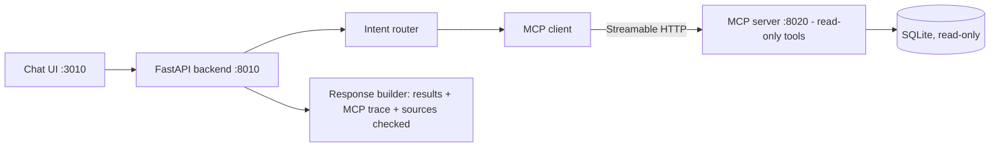

# MCP Data Assistant — Read-only ERP Chatbot over a Real MCP Server

[](https://github.com/NISHANTH-S-06/mcp-integration-project/actions/workflows/ci.yml)

A local, read-only ERP chatbot that answers from the connected SQLite database through a real MCP server. The FastAPI backend calls MCP tools, the frontend renders source-backed answers, and Ollama can optionally rewrite responses using only retrieved evidence.

## Architecture


## Features

- Real MCP server over Streamable HTTP at `http://127.0.0.1:8020/mcp`
- FastAPI backend at `http://127.0.0.1:8010`
- ERP chat dashboard frontend at `http://127.0.0.1:3010`
- Read-only SQLite access with path restrictions, query safety checks, and timeouts
- Structured chat responses with `primary_results`, `related_results`, `mcp_trace`, and `checked_sources`
- Optional local Ollama support; no OpenAI API key required

## Quick Start

```powershell
cd mcp-integration-project
python -m venv .venv
.venv\Scripts\python.exe -m pip install -r requirements.txt
# create the synthetic demo database (no real customer data)
.venv\Scripts\python.exe -m app.db_reader --init-demo-db
```

Start services in this order:

```powershell
.\run_mcp_server.bat
.\run_backend.bat
.\run_frontend.bat
```

Open:

| Service | URL |
| --- | --- |
| Chat UI | http://127.0.0.1:3010 |
| API | http://127.0.0.1:8010 |
| Health | http://127.0.0.1:8010/health |
| MCP Tools | http://127.0.0.1:8010/api/mcp/tools |
| API Docs | http://127.0.0.1:8010/docs |

## Demo mode vs. real ERP data

- **Demo mode (default in this repo)**: `python -m app.db_reader --init-demo-db` builds a synthetic SQLite database (fake companies such as ACME TRADERS). This is what CI and `verify.py` use.
- **Real mode**: point `.env` at a local read-only SQLite copy of an ERP database (`MCP_MODE=real`, `SQLITE_DB_PATH=...`). The ERP database itself is private and is **not** included in this repository. During the internship project it was a 676-table ERP database (about 4.4 million rows); the assistant opened it read-only and answered with source-backed results.

## Verification

```powershell
.venv\Scripts\python.exe verify.py
```

Useful smoke tests:

```powershell
Invoke-WebRequest http://127.0.0.1:8010/health -UseBasicParsing
Invoke-WebRequest http://127.0.0.1:8010/api/mcp/tools -UseBasicParsing
```

Chat questions to try:

- `Search customer ACME TRADERS`
- `Search invoice ABC25000001`
- `Search supplier INITECH DISTRIBUTORS`
- `GLOBEX MARKETING`
- `Show database overview`
- `Show sample rows from s_invoice_hdr_t`
- `Update customer record name to new`

## Safety

- Database opens through SQLite read-only URI mode.
- DB paths must stay inside the project `data/` directory.
- Write/destructive requests are blocked before reaching MCP tools.
- MCP exposes only read tools.
- The UI and API report source evidence and MCP trace metadata for database-backed answers.
